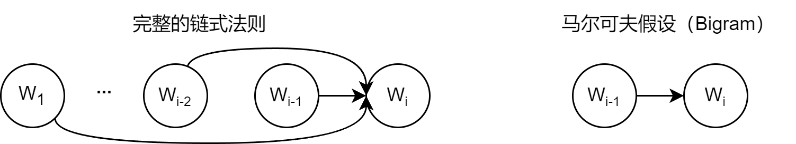
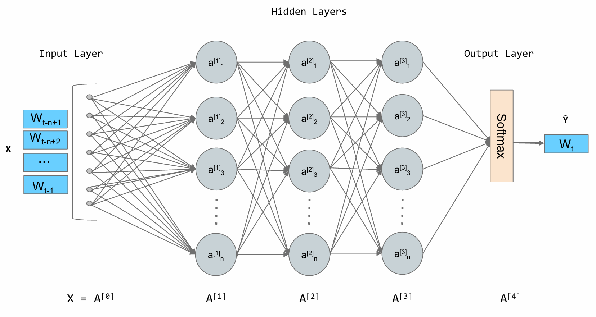
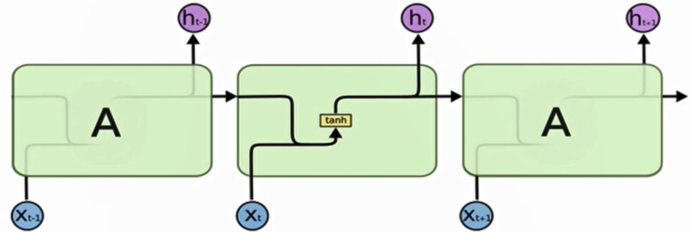
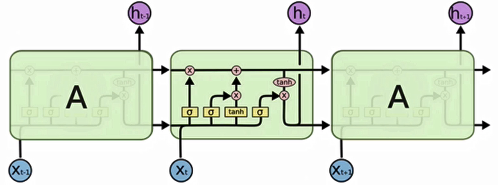
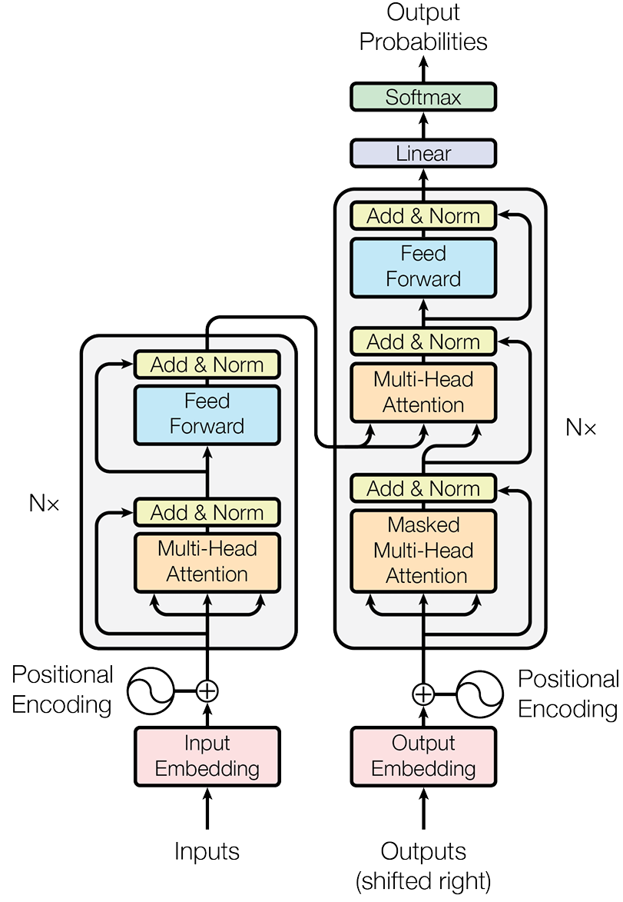

每天都在用 LLM，却很少回头想它是怎么一步步走到今天的。往前捋，我发现这条路出奇地干净，六代算法串成一条主线：

n-gram → FNN → RNN → LSTM → Transformer → Decoder-Only

而且每一步都不是凭空冒出来的新发明，而是被上一步的瓶颈逼出来的。它们从头到尾都在回答同一个问题——给定上文，下一个词是什么。变的只是上下文怎么被记住、被压缩、被取用。

## n-gram

“预测下一个词”，本质上是在**给一句话算概率**。一个句子 S 由 m 个词组成，它出现的概率按链式法则，可以拆成一串条件概率的连乘：

P(S) = P(w1, w2, …, wm) = P(w1) · P(w2|w1) · P(w3|w1,w2) · … · P(wm|w1,…,wm-1)

式子很精确，但越往后的条件越长，最后一个词的概率得背上前面全部的词，这在真实语料里根本估不出来。最早的做法非常朴素，把概率数出来。统计语料里“词 A 后面跟词 B”出现过多少次，挑概率最大的，这就是 n-gram 语言模型。为了不让条件无限增长，它做了马尔可夫假设，把每一项截断成只看最近 n-1 个词：

P(wi|w1,…,wi-1) ≈ P(wi|wi-n+1,…,wi-1)

常见的 bigram、trigram，就是把 n 取成 2 和 3。

完整链式法则与马尔可夫假设的对比

这套数出来的办法统治了语言建模几十年，但有两个天生的毛病。

- 数据稀疏：词的组合无穷，语料有限，“吃了个三明治”这种搭配就可能没出现过、概率为零，那整句话概率也是零。
- 泛化不足：它不认识“语义相似”，“猫”和“猫咪”毫不相干，“猫咪在睡觉”数得再多，“猫在睡觉”也还是没出现过，概率照样是零。

它记住了字面，却不知道意思。

## FNN

2003 年，Bengio 第一次让神经网络来做预测：**不数了，学。**

那篇[《A Neural Probabilistic Language Model》](https://www.jmlr.org/papers/v3/bengio03a.html)做了两件事，都成了后面的地基。

- 词向量：把每个词映射成一个低维稠密向量，“猫”和“猫咪”的向量会靠得很近，见过的组合会带出没见过的组合，稀疏和泛化的问题一下子松开了。
- 前馈神经网络（Feedforward Neural Network，FNN）：把固定窗口内几个词的向量拼起来喂给它，输出下一个词的概率分布。

FNN 的结构：输入层 → 隐藏层 → Softmax 输出

这是语言模型第一次有了“相似”的概念，词向量从此成了 NLP 的通用零件（后来的 [word2vec](https://arxiv.org/abs/1301.3781) 只是把它带火了）。

但它的局限也在这里：窗口是固定的。想看前 5 个词就设成 5，想看更远就得开更大的窗口，参数跟着涨。上下文长度被写死在了结构里，而语言里的依赖，远和近从来是说不准的。

## RNN

于是有了一个很自然的想法。能不能别让模型只看固定几个词，而是让它一边读、一边记？循环神经网络（Recurrent Neural Network，RNN）的答案是：**把读过的词，都记进一个状态里。**

每读一个词，就更新一次这个隐状态，ht = f(ht-1, xt)。这个向量承载“到目前为止读到的全部历史”，同一个网络、同一套参数，一步一步循环下去，所以理论上它能记住无限长的上文，参数量还不随上下文增长。

RNN 按时间展开：同一个隐状态沿时间步往下传

RNN 这个结构 1990 年前后就有了。2010 年 [RNNLM](https://doi.org/10.21437/Interspeech.2010-343) 把它用作语言模型，2014 年 [seq2seq](https://arxiv.org/abs/1409.3215) 用它做翻译，做法就是一读一写，编码器先把整句话读完，压成一个向量，解码器再从这个向量里吐出译文。

但 RNN 很快撞上了两堵墙。

- 记忆衰减：理论上无限长，实践里缩水得厉害。反向传播一路穿过时间步，梯度指数级衰减，开头的信息传不到结尾，像一场传话游戏。seq2seq 把整句压成一个向量，句子一长，译文后半段就开始不对劲。
- 并行受限：第 t 步必须等第 t-1 步算完，天然串行，GPU 再多也只能排队干等。

## LSTM

RNN 的第一堵墙（记忆衰减）早在 1997 年就被解决了，比上面那些应用还早。

那年 [LSTM](https://doi.org/10.1162/neco.1997.9.8.1735)（Long Short-Term Memory）**给记忆装上了门**：一条“记忆传送带”（cell state），再配三个门。遗忘门决定丢掉什么，输入门决定写入什么，输出门决定这一步吐出什么。信息在传送带上流动时，梯度可以几乎无损地回流，长距离依赖终于学得动了。

LSTM 单元内部：记忆传送带与三个门

2014 到 2017 年，LSTM 是当之无愧的主角，机器翻译、语音识别、文本生成全面开花，深度学习第一次在 NLP 上压过了统计方法。

但第二堵墙（串行）谁也绕不过去。而且隐状态这个瓶颈依然存在，无论前面读过多少内容，都只能挤进一个固定大小的向量，再传给下一步。

翻译领域先想出了一个聪明的补丁，让解码器不再只盯着那个句向量，而是回头去看编码器的所有位置，动态决定“现在该看哪些词”，这就是 2014 年提出的 [attention](https://arxiv.org/abs/1409.0473)，它其实已经撬开了瓶颈。

顺着这个思路再往下想一步，既然 attention 这么好用，还需要 RNN 吗？

## Transformer

2017 年，[《Attention Is All You Need》](https://arxiv.org/abs/1706.03762)给出的答案是：**不要了，用注意力取代循环。**

Transformer 的核心是自注意力，序列里每个位置都直接和所有位置计算相关性，再按相关性加权求和，得到自己的新表示。这一步没有任何顺序依赖，任意两个词之间的“距离”都是一步，模型可以一眼看全整句话，而且整句话的计算可以并行展开。

它的核心公式其实很好理解：

Attention(Q, K, V) = softmax(QKT / √d) · V

Q、K、V 都由输入算出来，QKT 是在问“每个位置该关注谁”，softmax 把分数变成权重，最后拿权重去加权汇聚 V，一次全局的、可学习的信息检索。再配上多头（同时从多个角度关注）、位置编码（补回顺序信息，因为注意力本身是无序的）、残差连接和 LayerNorm，一套结构就齐了。

Transformer 的编码器-解码器结构

好处立竿见影，训练可以并行，于是能吃满 GPU，吃下更大的数据和更大的模型。回头看，这正是通往大模型时代的门票。代价是注意力对序列长度是平方复杂度，长序列很贵，后来这么多年关于长上下文、[FlashAttention](https://arxiv.org/abs/2205.14135) 的工作，都是在还这笔账。

原版 Transformer 还是个 encoder-decoder，编码器负责理解，解码器负责生成。但它留下了三个能各自砍一刀的方向。

## Decoder-Only

2018 年，三条路几乎同时起步。

- [BERT](https://arxiv.org/abs/1810.04805)：只留编码器，用“完形填空”的方式学习，在各种理解任务上屠榜。
- [T5](https://arxiv.org/abs/1910.10683) 等：保留完整的 encoder-decoder。
- GPT：只留解码器，老老实实做一件事，自回归地预测下一个词。

当时没人敢说哪条路一定是终点。但后面的故事证明，**砍掉一半的 decoder-only，反而赢了**，赢在了“简单且自洽”上。

它简单到只剩一个目标，给定上文，预测下一个词。而你用它的时候，做的事情和训练时完全一样，也是一个词一个词往下接。训练和推理天然对齐，不需要额外的头、额外的结构。BERT 学得再好，想让它生成也得再想办法；encoder-decoder 多一半结构，就多一半的复杂。

更关键的是，这种统一和简单让它特别适合放大。同一个目标函数、同一套结构，参数从 1.17 亿（GPT-1）、15 亿（GPT-2，2019）一路加到 1750 亿（[GPT-3](https://arxiv.org/abs/2005.14165)，2020），模型不仅没崩，还冒出了谁也没设计过的新能力，不微调，只给几个例子，它就能照着干活，也就是 in-context learning。从这一刻起，“预训练一个大模型”这条路线被彻底锁定了。

2020 年之后，底层架构的大方向就没再变过，热闹都发生在别处，规模怎么加更划算（scaling law 与 [Chinchilla](https://arxiv.org/abs/2203.15556)）、输出怎么和人类偏好对齐（RLHF），以及这两年新的维度，把计算花在推理时（o1、R1 这类推理模型），再加上 MoE、长上下文这些结构与工程上的持续精进。

## 写在最后

把这条线连着看下来，每一步的因果都特别清楚。

n-gram 的数据稀疏和泛化不足，逼出了神经网络和词向量；FNN 的固定窗口，逼出了 RNN 的隐状态；RNN 的梯度消失，逼出了 LSTM 的门；LSTM 的串行与瓶颈，逼出了 Transformer 的注意力；Transformer 三足鼎立，最后收敛到 decoder-only。

而所有算法，无论哪一代，始终在回答同一个问题，给定上文，下一个词是什么。变的只是**上下文如何被记住、被压缩、被取用**。n-gram 靠计数窗口，FNN 靠固定窗口的向量拼接，RNN/LSTM 靠一个递归的隐状态，Transformer 靠注意力直接取用。到今天，这个“取用”的规模和精度，撑起了我们叫做“智能”的东西。

也正因为如此，这些老算法并不只是考古。位置编码为什么存在？因为注意力天生无序，这是 RNN 时代根本不用操心的问题；注意力为什么是平方复杂度？因为它用“一眼看全”换掉了“一步步传话”。理解当前模型的每一处设计，其实都是在理解它替代掉的那些旧痛点。
